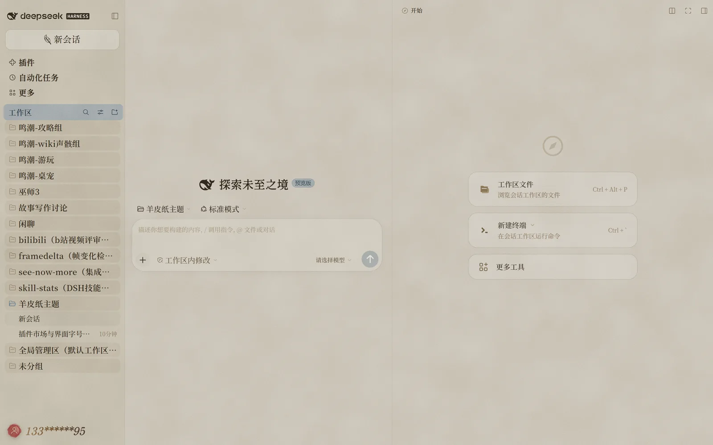
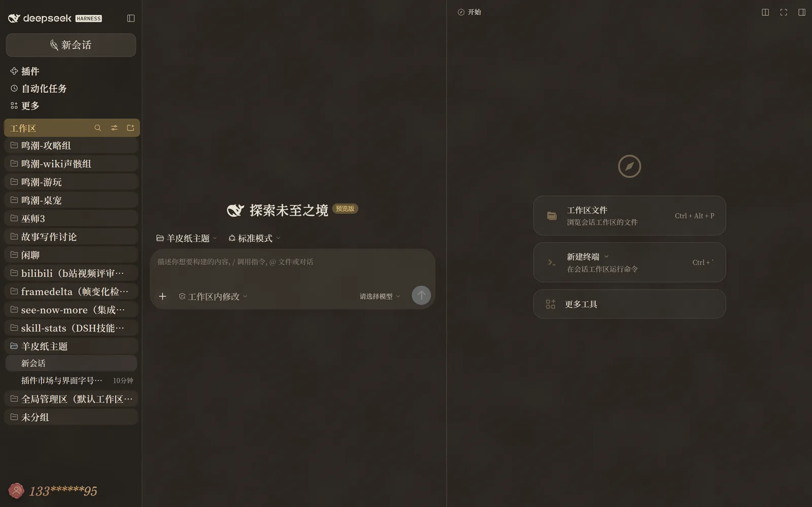

# 羊皮纸主题 · dsh-parchment-theme

把 DeepSeek Harness 的 Web 界面换成一套「旧纸 + 墨褐 + 宋体」的样子：浅色是**羊皮纸**，深色是**墨夜**，跟着系统的明暗自动切换。

只换皮，不动骨架：侧栏、会话、设置、插件市场还是原来的位置和操作，拉一个回车还是拉一个回车。

## 看效果

  
  

左浅右深，展示四块：设置里的「账号与余额」、外观三选一、对话里的「自动化任务」横幅（展开态）、以及定时任务卡。图是按应用里同一套组件样式与纸纹渲的，宽度等比缩到 1100px。

## 装与停

1. 把本仓库放到本地任意目录（或者解压 Release 里的包）。
2. 在 Harness 里执行 `plugin_manager → install_bundle`，`target` 填本目录的绝对路径。
3. **刷新页面**。之后改了样式表也是这样刷新，客户端模块不热更新。
4. 停用：`plugin_manager → set_plugin / set_bundle`（`enabled: false`），再刷新，界面回到出厂外观。

主题不占「设置 → 外观」里的位置（那里仍然只有 明 / 暗 / 跟随系统 三项），**开关就是插件的启停**。

## 你会看到什么

**纸面**
整页铺一层噪点纸纹（浏览器实时画的，不是图片素材），正文墨褐色，链接靛青。浅色底 `#C0B8A9` / 字 `#2A2219`；深色底 `#221D18` / 字 `#ECE1CB`。

**排印**
正文用思源宋体 CN Medium、18px；会话标题用寒蝉活宋体_復 Bold、21px；代码块正文 16px 斜体，标题「代码块」用猫啃网故障宋 20px 斜体；侧栏里工作区行 18px、会话行 16px、时间 13px，这一列的层级终于是看得出来的。

**侧栏**
「工作区」那一栏有色带（浅色灰蓝、深色暖褐配金字），工作区行有圆角垫底，一眼能分出分组和会话。新会话图标换成羽毛笔，「加载更早」旁边加了个沙漏。

**账号**
头像换成火漆印（侧栏 32px、设置页 40px）；账号名是横向棕金渐变的斜体，浅色深色各一组色。

**会话内容**
代码块有暖纸衬底和 1px 框线；「已编辑 N 个文件」卡片、交付文件卡片、定时任务卡、自动化任务横幅（含展开的正文）统一成同一族纸面，不再有白块从纸里「挖」出来的感觉；diff 的新增 / 删除行按纸色调过，墨色字压在衬底上仍然清楚。

**设置页**
整个面板放大到 1.15 倍，按钮、下拉、卡片有统一的表面；账号页的打码手机号、更多账号信息、余额行标签放大到 17px；「查询用量」做成「已激活外观卡」那种暖褐面，和「充值」区分开主次。

## 两套配色（选摘）

| 用途 | 羊皮纸（浅色） | 墨夜（深色） |
|---|---|---|
| 底纸 | `#C0B8A9` | `#221D18` |
| 卡片 / 代码块 | `#D2CCC2` | `#332C24` |
| 正文 | `#2A2219` | `#ECE1CB` |
| 用户气泡 | `#B8A987` | `#332D26` |
| 主按钮 | `#3A2E20` | `#E6DECE` |
| 链接 / 业务强调 | `#4A6172` | `#A3B4BF` |
| 成功 / 错误 / 警告 | `#4C7A5A` / `#A33C31` / `#A9772B` | 同色提亮 |

## 字体

这些字体本机要装好，主题里只声明家族名、不分发字体文件：

- **思源宋体 CN**（Medium、SemiBold）—— 正文与分组标题
- **寒蝉活宋体_復**（含 Bold）—— 会话标题、设置页导航、新会话大标题
- **猫啃网故障宋** —— 只用于代码块标题，没有就落到寒蝉
- **京華老宋体** —— 只用于「新会话」「加载更早」两处，没有就落到系统衬线

缺字体不会变成无衬线：字体栈最后兜到 `serif`。另外，如果你在「设置 → 通用 → 文本字体」里自己选了字体，那个选择仍然优先。

## 已知限制

这几处不是没做完，是改不到或者故意不改：

- 「设置 → 外观」里不会多出第四项，主题不占那个位置。
- 标题栏右侧的窗口按钮区、顶栏「应用 / 编辑」菜单、文字的右键菜单由系统和 Electron 画，不跟随配色。
- 开着主题时，「设置 → 通用 → 字号」和 `Ctrl + 加减` 不起作用——正文阶梯由主题定死。
- 只有浅色、深色两套，没有第三种。

## 想自己改

- **颜色**：`client.js` 顶部有两张表（`LIGHT` / `DARK`），改完刷新即可。
- **字号与个别组件**：同一文件下面的样式表字符串，按组件注释找对应那几行。
- **改完**跑一次 `node test/smoke.mjs`，CI 跑的也是这一条。
- 版本变化见 `CHANGELOG.md`；当初为什么这么做、踩过哪些坑见 `docs/决策记录.md`。

## 许可

MIT。字体由各自的授权方提供，本仓库不分发字体文件；纸纹是运行时生成的 SVG 噪声，不含任何素材图片。
